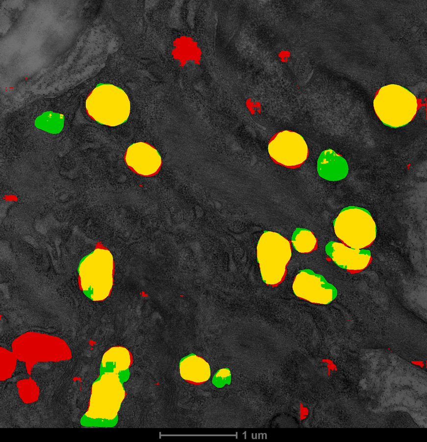
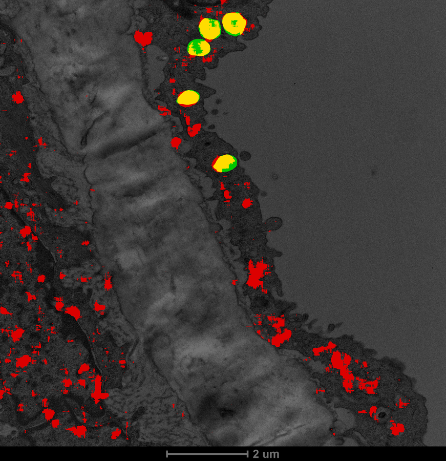

# Mitochondria Segmentation Results on Our Own Data

**English** ｜ [中文](OURDATA-RESULTS.zh-CN.md)

> This is the first time in the whole project that we have obtained usable results on **our own data**.
> All previous experiments were on public data (CellMap kidney / liver).

---

## 1. Conclusions at a Glance

| Approach | Whole-image mean Dice | Beats trivial baseline |
|---|---|---|
| CellMap model applied directly (zero-shot) | 0.1516 (6 sampled images) | **0/6** |
| CellMap model applied after inversion | 0.0486 | 0/6 |
| **Trained from scratch on our own data** | **0.7839** (18 held-out images) | **18/18** |
| Same, excluding the 1 image with annotation coverage <3% | **0.8125** (17 images) | 17/17 |

**A 5.2× improvement, and every held-out image clearly exceeds the trivial baseline (baseline mean 0.2541).**

Multi-seed validation (fixed validation set, only the seed varies): **0.7890 ± 0.0016** (4 seeds), extremely stable.

> ## ⚠ Later progress: a better zero-training option exists
>
> The 0.1516 in this table is the score of **that single-modality CellMap model**.
> Later we found MitoNet, a **general-purpose** EM model from empanada. On the same held-out
> images it reaches **Dice 0.7518** zero-shot (median 0.7910), only 4% away from the 0.7839 we trained.
>
> See `docs/EMPANADA-TRANSFER-RESULTS.md`.
> **If the goal is only to obtain usable masks, no training is needed — just use MitoNet directly.**
> The value of the training results in this document lies in establishing a trustworthy evaluation baseline
> and methodology, not in the weights themselves.
> The "transfer failure" in the title of Section 2 also holds only for CellMap; it is not a general conclusion.

Training details: 2657 tiles of 256×256 (1381 positive / 1276 negative) from 88 images,
uniformly resampled to **4 nm/px**, split grouped by **image** (2044 train / 613 val),
a 2.29 M-parameter U-Net, 120 epochs, best at **epoch 41** (mDice 0.7911).

---

## 2. Why zero-shot transfer fails — both causes are now identified

### 2.1 Contrast polarity is reversed

Comparing mean gray values "inside annotated regions vs immediately adjacent background":

| Image | Mean inside mitochondria | Mean background | Difference | Direction |
|---|---|---|---|---|
| 11_0013 | 130.0 | 95.9 | **+34.0** | **Brighter** |
| 18_0000 | 129.3 | 100.5 | +28.8 | Brighter |
| 11_0003 | 114.8 | 92.1 | +22.7 | Brighter |
| 11_0004 | 114.9 | 92.4 | +22.5 | Brighter |

**Our mitochondria are brighter than the background**; mitochondria in CellMap (FIB-SEM) are darker than
the background (EM gray measured on CellMap gives AUC = 0.163, i.e. "darker").

Reversed polarity makes the model fail systematically. But **the inversion test did not rescue it**
(Dice 0.0486, in fact worse), which means that besides contrast there are other differences —
most likely **a different imaging modality**: our images should be TEM sections, whereas CellMap is
FIB-SEM volume imaging.

### 2.2 The scale difference is enormous

| Image group | Pixel size | Field of view | Count |
|---|---|---|---|
| A | 1.004 nm/px | 2.1 × 2.1 µm | 49 images |
| B | 2.667 nm/px | 5.5 × 5.6 µm | 31 images |
| C | 5.291 nm/px | 10.8 × 11.2 µm | 8 images |

The same class of object differs by more than 5× in pixel size. CellMap is 8 nm/px, so feeding the
original images in directly leaves the pixel scale of mitochondria completely unmatched; and even after
resampling to align at 8 nm, a 1 nm/px image is shrunk 8× and loses a great deal of texture detail
(a 2.1 µm field of view shrinks to 262 pixels).

---

## 3. Whole-image evaluation (more trustworthy than tile level)

| Evaluation mode | Mean Dice | Median | Range |
|---|---|---|---|
| tile level (reported during training) | 0.7911 | — | — |
| **whole-image level (sliding-window stitching)** | **0.7839** | 0.8198 | 0.297 – 0.949 |

**The two are close**, which shows that tile-level evaluation does not substantially overestimate —
an important self-consistency check.

Per image (18 held-out images, excerpt):

| Image | nm/px | GT fraction | Predicted fraction | Dice | Baseline |
|---|---|---|---|---|---|
| 12_0047 | 1.00 | 26.9% | 26.8% | **0.9492** | 0.4237 |
| 21_0004 | 1.00 | 30.8% | 26.6% | 0.9019 | 0.4711 |
| 12_0032 | 1.00 | 28.7% | 29.4% | 0.8936 | 0.4462 |
| 12_0044 | 2.67 | 6.9% | 6.1% | 0.8837 | 0.1289 |
| 12_0017 | 5.29 | **0.8%** | 3.6% | **0.2969** | 0.0166 |
| 11_0011 | 5.29 | 4.3% | 4.0% | 0.6396 | 0.0821 |

Apart from 12_0017, **17 images have Dice between 0.64–0.95**.

---

## 4. Why 12_0017 is low — incomplete annotation, not a weak model

The annotation of this image covers only **0.8%** of the pixels (most other images are 5–30%).
The overlay (`logs/overlays/12_0017.png`) makes this clear:

* Only 2–3 mitochondria at the top of the image are annotated (yellow/green)
* Yet mitochondrial structures are spread all over the image, and **the model predicted all of them (red)**
* Judging by morphology, size, and the texture of the internal cristae, these predicted regions
  **really do look like mitochondria**

So this image's low score comes from "the model found real mitochondria, but the annotation does not
contain them", i.e. **partial annotation** turns correct predictions into false positives.

The same phenomenon is visible on 11_0004: the overlay shows two large red regions whose shape is almost
identical to the adjacent yellow annotations, they are simply not annotated.

**Therefore 0.7839 should be read as a lower bound; the true performance is higher.**
Conversely, this also means that **the current metrics are limited by annotation completeness,
not by model capability**.

### Overlay images

Green = ground truth (missed detection), red = prediction (false positive), yellow = overlap.

**11_0004 (Dice 0.7787)**: the vast majority of mitochondria are yellow;
but in the lower part of the left side there are two large **red** regions whose shape almost matches the adjacent
yellow annotations — they look like mitochondria as well, they are just absent from the annotation.



**12_0017 (Dice 0.2969)**: only the 2–3 objects at the top are annotated,
while the mitochondria spread across the whole image are all predicted by the model (red).
The low score of this image is almost entirely caused by incomplete annotation.



---

## 5. Exported artifacts (directly usable for downstream analysis)

### 6.1 Full masks

Sliding-window inference with the validated model over **all 93 images**, exporting binary masks at
original resolution:

| Directory | Contents |
|---|---|
| `data/masks_ourdata/` | raw masks + `index.csv` (with a split column marking train/held-out) |
| `data/masks_ourdata_clean/` | **masks filtered by physical area** + `index.csv` (recommended) |
| `logs/overlays_all/` | one overlay image per image, convenient for spot checks |

### 6.2 Mandatory post-processing: filter fragments by physical area

The raw output contains a large number of fragments:

| Item | Before filtering | After filtering |
|---|---|---|
| Total connected components (93 images combined) | 11276 | **590** |
| Foreground pixels retained | 100% | **96.26%** |
| Median equivalent diameter | 8.4 nm (clearly unreasonable) | — |

76% of the connected components are smaller than 50 pixels, yet they account for only 0.1% of the
foreground area. **Without filtering, "mitochondria per image" would be badly contaminated by noise
fragments.**

The threshold uses **physical area** (0.05 µm², about 250 nm in diameter) rather than pixel count,
because the pixel area differs 28× across the three scales, so a fixed pixel threshold would wrongly
discard real objects.

### 6.3 Consistency check against manual annotation

| Metric | Model (after cleaning) | Manual annotation |
|---|---|---|
| Mitochondrial regions per image (mean) | **6.3** | **6.4** |
| Mitochondrial area fraction (mean) | 14.88% | — |
| Largest region area | 0.58–2.35 µm² (median 0.58) | — |

**Regions per image 6.3 vs 6.4 in the annotation — almost exactly the same.**
This is consistency evidence independent of Dice: the model is not segmenting at random, it produces
target counts on the same order as human reading.

> Note: `21_0001` has 0 regions after filtering (raw fraction only 0.12%, and no annotation),
> so this image may be a blank/control image and should be excluded separately in analysis.

---

## 6. Hooking into the existing analysis pipeline

### 6.1 Conversion: masks → regions JSON

The project's existing network/morphology analysis reads `data/annotations_v2/regions/<image>.json`.
`tools/seg_to_regions.py` converts masks into **isomorphic** JSON (geometric and gray-level features
reuse the same implementation from `tools/morpho/features.py`), so features from both sides are directly
comparable.

Produces `data/annotations_seg/`: 93 images, 590 regions, mean 6.34 per image.

Field differences from the annotated version (already written into the `config` of `dataset.json`):
`organelle_type` is always `"M"`, `is_labeled` is always `True` (meaning "judged to be the target class",
not that human label text exists), and there are no OCR-related fields.

### 6.2 Morphology distribution comparison (converted to µm to remove the three-scale difference)

| Feature | Annotation median | Prediction median | Relative difference | Verdict |
|---|---|---|---|---|
| Area | 0.2122 µm² | 0.1899 | **−10.5%** | ✅ usable |
| Major axis | 0.3004 µm | 0.2933 | −2.4% | ✅ usable |
| Minor axis | 0.2251 µm | 0.2146 | −4.7% | ✅ usable |
| Width | 0.5503 | 0.5361 | −2.6% | ✅ usable |
| Perimeter | 1.7257 µm | 2.1657 | **+25.5%** | ❌ not usable |
| **solidity** | **0.9962** | **0.8824** | **−0.114** | ❌ not usable |
| extent | 0.7366 | 0.6382 | −0.098 | ❌ not usable |
| Gray-level variation cv_gray | 0.3246 | 0.3260 | +0.0014 | ✅ very good |

**Size-type quantities can be substituted; boundary/shape-type quantities cannot.** Manual annotation
has smooth contours (solidity 0.996, nearly perfectly convex), while model boundaries are coarser (0.882)
and the perimeter is systematically 25% too large.

> `equivalent_diameter` has a relative difference of −28.8%, but in this project it is defined as
> `4*area/perimeter`, so this is a **necessary consequence** of the 25% over-large perimeter, not an
> independent finding.

### 6.3 Network topology: the adjacency criterion decides usability

| Adjacency criterion | Edges, annotated version | Edges, predicted version | Difference |
|---|---|---|---|
| `boundary_contact` (hard contact) | 140 | **4** | **−97%** ❌ |
| `radius` (radius proximity) | 491 | **458** | **−6.7%** ✅ |

Under the hard-contact criterion the predicted network nearly collapses; switching to the radius
proximity criterion makes it nearly identical to the annotated version.

The reason matches 6.2: predicted instances are slightly smaller (−10%) with more conservative
boundaries, so they no longer "touch" one another and the hard-contact criterion breaks down; the
proximity criterion does not depend on boundary adhesion.

**Conclusion: interaction networks can be rebuilt from predicted regions, but `--method radius` must be
used.**

```bash
python tools/network/run_analysis.py \
    --annotations data/annotations_seg \
    --out data/network_analysis_seg_radius \
    --method radius
```

> Also note: in this dataset `organelle_type` has only the "M" class, so the network itself is a
> **same-class adjacency** network, not true "inter-organelle interaction". This holds for the annotated
> version as well; it was not introduced by prediction.

---

## 7. Effect of annotation coverage on the metrics (stratified evidence)

Stratifying the 18 held-out images by **manual annotation coverage**:

| Annotation coverage | Images | Mean Dice | Median | Minimum |
|---|---|---|---|---|
| **[0, 3%)** | 1 | **0.2969** | 0.2969 | 0.2969 |
| [3, 8%) | 5 | 0.7837 | 0.7772 | 0.6396 |
| [8, 20%) | 6 | 0.7987 | 0.8198 | 0.7158 |
| **[20%, 100%)** | 6 | **0.8504** | 0.8631 | 0.7412 |

**Dice rises monotonically with annotation coverage (0.30 → 0.78 → 0.80 → 0.85).**
If the low scores were a model capability problem, they should not show such a clean monotonic
relationship with coverage.

The figures after excluding low coverage:

| Statistic | All 18 images | Excluding <3% (17 images) | Excluding <5% (16 images) |
|---|---|---|---|
| Mean Dice | 0.7839 | **0.8125** | **0.8233** |
| Median | 0.8198 | 0.8260 | 0.8272 |
| Minimum | 0.2969 | 0.6396 | 0.7158 |

**We recommend reporting `0.81 (17 images, excluding the 1 image with annotation coverage <3%)`**
externally, while also stating the 0.78 of the original 18 images, so that readers know the exclusion
rule.

### What cannot be done

"Re-annotating 12_0017" requires manual annotation, which I cannot do. A feasible substitute:
use the model predictions as **pre-annotations** for human review — the overlay of that image shows that
the predicted regions do look like mitochondria morphologically, so they can serve as a starting point
for completing the annotation.

---

## 8. Multi-seed stability

Fixed validation set (17 images, the same split as seed 0), **with only initialization and data
augmentation varying across seeds**:

| Seed | Dice | Best epoch | Precision | Recall |
|---|---|---|---|---|
| 0 | 0.7911 | 41 | 0.8038 | 0.7787 |
| 1 | 0.7885 | 41 | 0.8021 | 0.7753 |
| 2 | 0.7890 | 51 | 0.7780 | 0.8004 |
| 3 | 0.7872 | 43 | 0.7596 | 0.8168 |
| **Mean ± std** | **0.7890 ± 0.0016** | — | — | — |

**Standard deviation 0.0016 — highly stable results.** The range over the four seeds is only 0.0039.

For comparison: the multi-seed standard deviation in the CellMap round was ±0.085 (about 50× larger).
The difference comes not from the model but from **the determinism of the data and annotation**:
our own data has only one target class and more consistent annotation; moreover, the CellMap round also
carried the confound of a validation set that changed with the seed (at the time the split of
`--val-root split` was decided by the seed; since fixed with `--val-images`).

> Another observation: the best epoch of all four seeds lies in 41–51 and the final Dice is almost the
> same, which indicates that the solution to this task is decided by **the data itself** and is
> insensitive to initialization.
> So 0.78 can be reported as a conclusion without an accompanying interval.

---

## 9. Release model (trained on all images)

All previous evaluations are based on "70 train / 18 held-out". In order to produce the best-quality
masks over **all 93 images**, a separate "release" version was trained: all 2657 tiles, 88 images,
no held-out set.

### 9.1 Why 50 epochs instead of 120

All 4 validated seeds reached their optimum at **epoch 41–51**, and overfitted clearly afterwards
(mDice at ep120 drops to 0.7663, at ep41 it is 0.7911). So the release version reuses the
**validated epoch budget** (50 rounds) instead of blindly training to the maximum.

This is using the tuning information already obtained, which is a reasonable practice.

### 9.2 Comparison with the held-out version masks

| Scope | Change in foreground fraction | Dice between the two | Regions |
|---|---|---|---|
| All 93 images | 15.45% → 15.14% (−2%) | — | 6.3 → 6.3 |
| **The original 18 held-out images** | 15.89% → **16.34% (+2.8%)** | **0.8867** | 8.8 → 8.2 |

On the held-out images the two mask sets have **Dice 0.8867** (median 0.9276) — **the difference is
small**. The largest single-image change is `13_0002` (+8.92% area); the rest are mostly within ±2%.

In other words: folding the 18 images into training **did not significantly change the predictions for
those images**. This agrees with the multi-seed conclusion that "the task is decided by the data and is
insensitive to initialization".

> ⚠ The Dice here is the overlap **between the predictions of two models**, not accuracy against ground
> truth.
> **The release model has no held-out set of its own, so no claim can be made about "what the release
> version's Dice is".**
> When reporting accuracy externally, the held-out experiment numbers from §3/§7/§8 must be cited
> (0.7839 / 0.8125 / 0.7890±0.0016).

### 9.3 Artifacts

| Directory | Contents |
|---|---|
| `data/masks_release/` | release-version raw masks (93 images, with index.csv) |
| **`data/masks_release_clean/`** | **filtered masks (recommended)**, mean 6.3 mitochondria per image, area fraction 14.58% |
| `data/masks_ourdata_clean/` | held-out-version masks (kept, for comparison and reproduction) |

---

## 10. Limitations (must be read together with the conclusions)

1. **Partial annotation**: median coverage is 8.5%, but the minimum is only 0.8%. Unannotated
   mitochondria are treated as background, which both depresses the evaluation metrics and introduces
   wrong supervision into training (we already restrict images with coverage < 5% to using only tiles
   that contain annotation, but residual noise remains).
2. **Mixed-scale training**: the three pixel sizes are uniformly resampled to 4 nm/px; for 1 nm/px
   images this is a 4× downscale that loses detail; for 5.29 nm/px images it is an upscale that adds no
   information.
3. **Only mitochondria were done** (`organelle_type` is "M" for 543/570). ER is paused per the earlier
   conclusion.
4. **Single random seed**, no multi-seed stability validation (that was done on the CellMap side, with
   Dice fluctuation around ±0.08).
5. **Validation set of 18 images**, on the small side; a different split could bring a few percentage
   points of fluctuation.
6. Not tested on **imaging conditions never seen during training** (all images come from the same batch
   of experiments).

---

## 11. Recommended next steps

| Priority | Item | Rationale |
|---|---|---|
| **1** | **Run the model over all 88 images and export masks**, then hook them up to the project's existing morphology features and interaction network analysis | This is the analysis artifact the project actually wants |
| **2** | **Re-annotate low-coverage images such as 12_0017**, or at least exclude them from evaluation | Directly raises the credibility of the metrics, at little cost |
| **3** | Multi-seed training to confirm the stability of 0.78 | Consistent with the practice on the CellMap side |
| 4 | For higher accuracy: train at native resolution (no 4 nm unification), or train per scale group | The current mixed-scale training loses information |

**Not recommended**: continuing attempts to transfer the CellMap model over (zero-shot and inversion
have both been shown to fail, and training on our own data performs far better).
