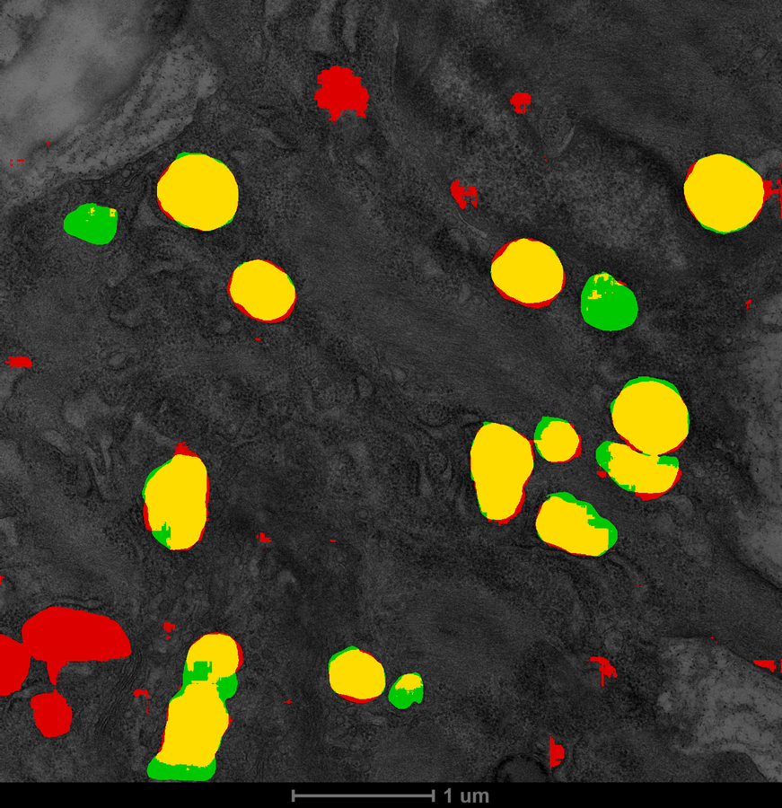
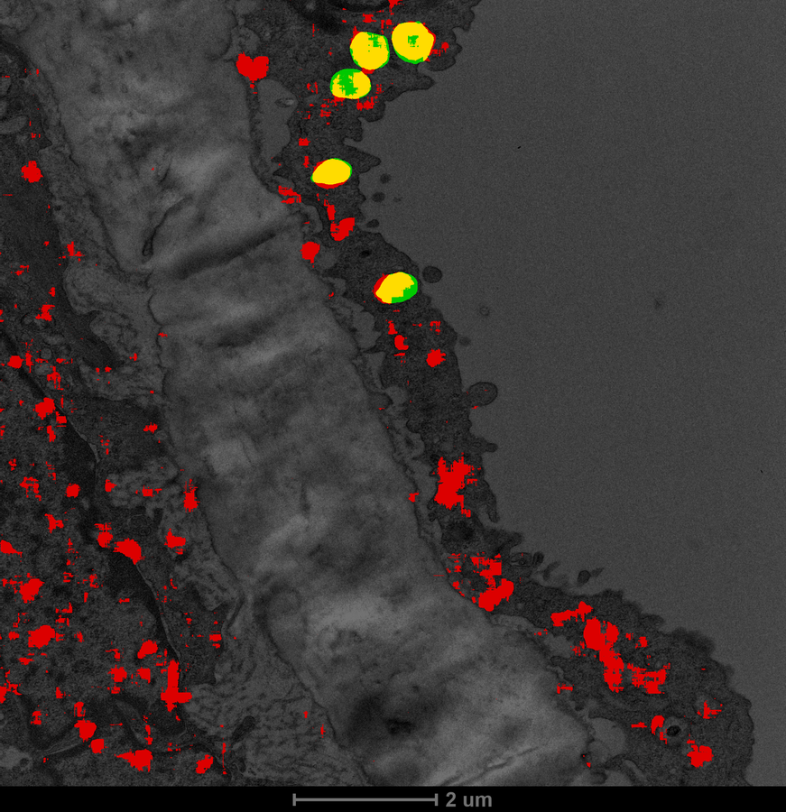

# 自有数据上的线粒体分割结果

[English](OURDATA-RESULTS.md) ｜ **中文**

> 这是整个项目第一次在**我们自己的数据**上得到可用结果。
> 此前所有实验都在公开数据（CellMap kidney / liver）上。

---

## 1. 结论速览

| 方案 | 全图 Dice 均值 | 超过平凡基线 |
|---|---|---|
| CellMap 模型直接应用（零样本） | 0.1516（6 张抽样） | **0/6** |
| CellMap 模型反相后应用 | 0.0486 | 0/6 |
| **在自有数据上从头训练** | **0.7839**（18 张留出图） | **18/18** |
| 同上，剔除标注覆盖 <3% 的 1 张 | **0.8125**（17 张） | 17/17 |

**提升 5.2 倍，且全部留出图明显超过平凡基线（基线均值 0.2541）。**

多种子验证（固定验证集，只变种子）：**0.7890 ± 0.0016**（4 个种子），极其稳定。

> ## ⚠ 后续进展：有更好的零训练方案
>
> 本表里的 0.1516 是 **CellMap 那个单一模态模型**的成绩。
> 后来找到 empanada 的**通用** EM 模型 MitoNet，同一批留出图上零样本
> **Dice 0.7518**（中位 0.7910），与我们训练的 0.7839 只差 4%。
>
> 详见 `docs/EMPANADA-TRANSFER-RESULTS.zh-CN.md`。
> **若目标只是拿到可用掩码，不需要训练——直接用 MitoNet 即可。**
> 本文档的训练结果价值在于建立了可信的评估基线与手段，而不在于权重本身。
> 第 2 节标题里的"迁移失败"也只对 CellMap 成立，不是普遍结论。

训练细节：2657 个 256×256 tile（正 1381 / 负 1276），来自 88 张图，
统一重采样到 **4 nm/px**，按**图像**分组划分（2044 训练 / 613 验证），
2.29 M 参数 U-Net，120 epoch，最优在 **epoch 41**（mDice 0.7911）。

---

## 2. 为什么零样本迁移失败——两个原因都查清了

### 2.1 对比度方向相反

用"标注区域内 vs 紧邻背景"的灰度均值比较：

| 图像 | 线粒体内均值 | 背景均值 | 差值 | 方向 |
|---|---|---|---|---|
| 11_0013 | 130.0 | 95.9 | **+34.0** | **更亮** |
| 18_0000 | 129.3 | 100.5 | +28.8 | 更亮 |
| 11_0003 | 114.8 | 92.1 | +22.7 | 更亮 |
| 11_0004 | 114.9 | 92.4 | +22.5 | 更亮 |

**我们的线粒体比背景亮**；而 CellMap（FIB-SEM）的线粒体比背景暗
（在 CellMap 上实测 EM 灰度的 AUC = 0.163，即"更暗"）。

方向相反会让模型系统性失效。但**反相测试没有救回**（Dice 0.0486，反而更差），
说明除了对比度还有别的差异——最可能是**成像模态不同**：
我们的图应为 TEM 切片，CellMap 是 FIB-SEM 块体成像。

### 2.2 尺度差异巨大

| 图像组 | 像素尺寸 | 视野 | 数量 |
|---|---|---|---|
| A | 1.004 nm/px | 2.1 × 2.1 µm | 49 张 |
| B | 2.667 nm/px | 5.5 × 5.6 µm | 31 张 |
| C | 5.291 nm/px | 10.8 × 11.2 µm | 8 张 |

同一类物体在像素上的尺寸差 5 倍以上。CellMap 是 8 nm/px，
所以直接喂原图时线粒体的像素尺度完全对不上；
即使重采样对齐到 8 nm，1 nm/px 的图会被缩小 8 倍，
纹理细节大量丢失（2.1 µm 视野缩到 262 像素）。

---

## 3. 全图评估（比 tile 级更可信）

| 评估方式 | Dice 均值 | 中位 | 范围 |
|---|---|---|---|
| tile 级（训练时报告） | 0.7911 | — | — |
| **全图级（滑窗拼接）** | **0.7839** | 0.8198 | 0.297 – 0.949 |

**两者接近**，说明 tile 级评估没有明显高估——这是一个重要的自洽性检查。

逐图（18 张留出图，节选）：

| 图像 | nm/px | GT 占比 | 预测占比 | Dice | 基线 |
|---|---|---|---|---|---|
| 12_0047 | 1.00 | 26.9% | 26.8% | **0.9492** | 0.4237 |
| 21_0004 | 1.00 | 30.8% | 26.6% | 0.9019 | 0.4711 |
| 12_0032 | 1.00 | 28.7% | 29.4% | 0.8936 | 0.4462 |
| 12_0044 | 2.67 | 6.9% | 6.1% | 0.8837 | 0.1289 |
| 12_0017 | 5.29 | **0.8%** | 3.6% | **0.2969** | 0.0166 |
| 11_0011 | 5.29 | 4.3% | 4.0% | 0.6396 | 0.0821 |

除 12_0017 外，**17 张的 Dice 在 0.64–0.95**。

---

## 4. 12_0017 为什么低——标注不完整，不是模型差

这张图的标注只覆盖 **0.8%** 的像素（其余图多为 5–30%）。
叠加图（`logs/overlays/12_0017.png`）看得很清楚：

* 标注只有图像上方 2–3 个线粒体（黄色/绿色）
* 但整幅图里遍布线粒体结构，**模型把它们都预测出来了（红色）**
* 从形态、尺寸、内部嵴的纹理看，这些被预测的区域**确实像线粒体**

所以这张图的低分来自"模型找到了真线粒体，但标注里没有它们"，
即**部分标注**把正确的预测算成了假阳性。

这个现象在 11_0004 上同样可见：叠加图里有两块大的红色区域，
形状和旁边的黄色标注几乎一样，只是未被标注。

**因此 0.7839 应当理解为下界，真实性能更高。**
反过来说，这也意味着**当前指标受标注完整性限制，而不是受模型能力限制**。

### 叠加图

绿 = 真值（漏检）、红 = 预测（误报）、黄 = 重合。

**11_0004（Dice 0.7787）**：绝大多数线粒体是黄色；
但左侧中下有两块大的**红色**区域，形状与旁边的黄色标注几乎一致——
它们看起来同样是线粒体，只是标注里没有。



**12_0017（Dice 0.2969）**：标注只有上方 2–3 个，
而整幅图里遍布的线粒体全部被模型预测出来（红色）。
这张图的低分几乎完全由标注不完整造成。



---

## 5. 已导出的产物（可直接用于后续分析）

### 6.1 全量掩码

用验证过的模型对**全部 93 张图**做滑窗推理，导出原分辨率二值掩码：

| 目录 | 内容 |
|---|---|
| `data/masks_ourdata/` | 原始掩码 + `index.csv`（含 split 列标明训练/留出） |
| `data/masks_ourdata_clean/` | **按物理面积过滤后的掩码** + `index.csv`（推荐使用） |
| `logs/overlays_all/` | 每张图的叠加图，便于抽查 |

### 6.2 必须做的后处理：按物理面积过滤碎片

原始输出有大量碎片：

| 项 | 过滤前 | 过滤后 |
|---|---|---|
| 连通域总数（93 张合计） | 11276 | **590** |
| 前景像素保留 | 100% | **96.26%** |
| 中位等效直径 | 8.4 nm（明显不合理） | — |

76% 的连通域小于 50 像素，却只占前景面积的 0.1%。
**若不过滤，"每图线粒体数"会被噪声碎片严重污染。**

阈值用**物理面积**（0.05 µm²，约直径 250 nm）而不是像素数，
因为三种尺度的像素面积差 28 倍，固定像素阈值会误伤。

### 6.3 与人工标注的一致性检查

| 指标 | 模型（清洗后） | 人工标注 |
|---|---|---|
| 每图线粒体区域数（均值） | **6.3** | **6.4** |
| 线粒体面积占比（均值） | 14.88% | — |
| 最大区域面积 | 0.58–2.35 µm²（中位 0.58） | — |

**每图区域数 6.3 vs 标注 6.4——几乎完全一致。**
这是一个独立于 Dice 的一致性证据：模型不是在胡乱分割，
而是给出了与人工判读同量级的目标数量。

> 注：`21_0001` 过滤后为 0 个区域（原始占比仅 0.12%，且无标注），
> 该图可能是空白/对照图，分析时应单独排除。

---

## 6. 接入现有分析管线

### 6.1 转换：掩码 → regions JSON

项目已有的网络/形态学分析读的是 `data/annotations_v2/regions/<image>.json`。
`tools/seg_to_regions.py` 把掩码转成**同构**的 JSON（几何与灰度特征
复用 `tools/morpho/features.py` 的同一套实现），因此两边特征可直接对比。

产出 `data/annotations_seg/`：93 张图、590 个区域、每图平均 6.34。

与标注版的字段差异（已写进 `dataset.json` 的 `config`）：
`organelle_type` 恒为 `"M"`、`is_labeled` 恒 `True`（表示"被判为目标类别"，
不代表有人工标签文字）、无 OCR 相关字段。

### 6.2 形态学分布对比（换成 µm 以消除三种尺度差异）

| 特征 | 标注中位 | 预测中位 | 相对差 | 判定 |
|---|---|---|---|---|
| 面积 | 0.2122 µm² | 0.1899 | **−10.5%** | ✅ 可用 |
| 长轴 | 0.3004 µm | 0.2933 | −2.4% | ✅ 可用 |
| 短轴 | 0.2251 µm | 0.2146 | −4.7% | ✅ 可用 |
| 宽度 | 0.5503 | 0.5361 | −2.6% | ✅ 可用 |
| 周长 | 1.7257 µm | 2.1657 | **+25.5%** | ❌ 不可用 |
| **solidity** | **0.9962** | **0.8824** | **−0.114** | ❌ 不可用 |
| extent | 0.7366 | 0.6382 | −0.098 | ❌ 不可用 |
| 灰度变异 cv_gray | 0.3246 | 0.3260 | +0.0014 | ✅ 很好 |

**尺寸类量可以替代，边界/形状类量不行。** 人工标注是平滑轮廓
（solidity 0.996 近乎完美凸），模型边界更粗糙（0.882），周长系统性偏大 25%。

> `equivalent_diameter` 相对差 −28.8%，但该项目里它的定义是
> `4*area/perimeter`，所以这是周长偏大 25% 的**必然推论**，不是独立发现。

### 6.3 网络拓扑：邻接判据决定可用性

| 邻接判据 | 标注版边数 | 预测版边数 | 差异 |
|---|---|---|---|
| `boundary_contact`（硬接触） | 140 | **4** | **−97%** ❌ |
| `radius`（距离邻近） | 491 | **458** | **−6.7%** ✅ |

硬接触判据下预测网络几乎崩溃；换成距离邻近判据后与标注版几乎一致。

原因与 6.2 一致：预测实例略小（−10%）、边界更保守，彼此不再"接触"，
硬接触判据失效；proximity 判据不依赖边界贴合。

**结论：可以用预测区域重建互作网络，但必须用 `--method radius`。**

```bash
python tools/network/run_analysis.py \
    --annotations data/annotations_seg \
    --out data/network_analysis_seg_radius \
    --method radius
```

> 另注：本数据 `organelle_type` 只有 "M" 一类，所以网络本身是**同类相邻**网络，
> 不是真正的"异种细胞器互作"。这一点在标注版同样存在，不是预测引入的。

---

## 7. 标注覆盖率对指标的影响（分层证据）

把 18 张留出图按**人工标注的覆盖率**分层：

| 标注覆盖率 | 图数 | Dice 均值 | 中位 | 最小 |
|---|---|---|---|---|
| **[0, 3%)** | 1 | **0.2969** | 0.2969 | 0.2969 |
| [3, 8%) | 5 | 0.7837 | 0.7772 | 0.6396 |
| [8, 20%) | 6 | 0.7987 | 0.8198 | 0.7158 |
| **[20%, 100%)** | 6 | **0.8504** | 0.8631 | 0.7412 |

**Dice 随标注覆盖率单调上升（0.30 → 0.78 → 0.80 → 0.85）。**
若低分是模型能力问题，不应与覆盖率呈这么干净的单调关系。

剔除低覆盖后的口径：

| 统计 | 全部 18 张 | 剔除 <3%（17 张） | 剔除 <5%（16 张） |
|---|---|---|---|
| Dice 均值 | 0.7839 | **0.8125** | **0.8233** |
| 中位 | 0.8198 | 0.8260 | 0.8272 |
| 最小 | 0.2969 | 0.6396 | 0.7158 |

**建议对外报 `0.81（17 张，剔除标注覆盖 <3% 的 1 张）`**，
同时说明原始 18 张的 0.78，让读者知道剔除规则。

### 无法做的那部分

"补标 12_0017"需要人工标注，我做不了。可行替代：
用模型预测作为**预标注**供人工复核——该图的叠加图显示预测区域形态上确实
像线粒体，可作为补标起点。

---

## 8. 多种子稳定性

固定验证集（17 张图，与 seed 0 相同的划分），**只让初始化与数据增广随种子变化**：

| 种子 | Dice | 最优 epoch | Precision | Recall |
|---|---|---|---|---|
| 0 | 0.7911 | 41 | 0.8038 | 0.7787 |
| 1 | 0.7885 | 41 | 0.8021 | 0.7753 |
| 2 | 0.7890 | 51 | 0.7780 | 0.8004 |
| 3 | 0.7872 | 43 | 0.7596 | 0.8168 |
| **均值 ± 标准差** | **0.7890 ± 0.0016** | — | — | — |

**标准差 0.0016——结果高度稳定。** 四个种子的极差只有 0.0039。

对照：CellMap 那轮的多种子标准差是 ±0.085（约 50 倍大）。
差别来源不是模型，而是**数据与标注的确定性**：自有数据只有一类目标、标注更一致；
而且 CellMap 那轮还叠加了验证集随种子变化的混淆
（当时 `--val-root split` 的划分由 seed 决定，已用 `--val-images` 修正）。

> 另一个观察：四个种子的最优 epoch 都在 41–51，最终 Dice 几乎相同，
> 说明这个任务的解由**数据本身**决定，对初始化不敏感。
> 因此 0.78 可以作为结论报告，不必附带区间。

---

## 9. 发布版模型（用全部图像训练）

前面所有评估都基于"70 张训练 / 18 张留出"。为了在**全部 93 张**上给出质量最好的
掩码，另外训练了一个"发布版"：全部 2657 个 tile、88 张图、无留出。

### 9.1 为什么用 50 epoch 而不是 120

已验证的 4 个种子都在 **epoch 41–51** 达到最优，之后明显过拟合
（ep120 的 mDice 掉到 0.7663，ep41 是 0.7911）。所以发布版沿用**已验证的
epoch 预算**（50 轮），而不是盲目训满。

这是使用已获得的调参信息，属于合理做法。

### 9.2 与留出版掩码的对比

| 口径 | 前景占比变化 | 两者 Dice | 区域数 |
|---|---|---|---|
| 全部 93 张 | 15.45% → 15.14%（−2%） | — | 6.3 → 6.3 |
| **原来留出的 18 张** | 15.89% → **16.34%（+2.8%）** | **0.8867** | 8.8 → 8.2 |

两套掩码在留出图上 **Dice 0.8867**（中位 0.9276）——**差异不大**。
最大单张变化是 `13_0002`（+8.92% 面积），其余多在 ±2% 内。

也就是说：把 18 张纳入训练，**并没有显著改变对这些图的预测**。
这与"任务由数据决定、对初始化不敏感"的多种子结论一致。

> ⚠ 这里的 Dice 是**两个模型预测之间**的重合度，不是对真值的准确率。
> **发布版模型没有自己的留出集，因此不能声称"发布版的 Dice 是多少"。**
> 对外报告精度时必须引用 §3/§7/§8 的留出实验数字（0.7839 / 0.8125 / 0.7890±0.0016）。

### 9.3 产物

| 目录 | 内容 |
|---|---|
| `data/masks_release/` | 发布版原始掩码（93 张，含 index.csv） |
| **`data/masks_release_clean/`** | **过滤后掩码（推荐）**，每图平均 6.3 个线粒体，面积占比 14.58% |
| `data/masks_ourdata_clean/` | 留出版掩码（保留，用于对比与复现） |

---

## 10. 局限（必须与结论一起读）

1. **部分标注**：中位覆盖率 8.5%，但最低仅 0.8%。未标注的线粒体被当作背景，
   既压低评估指标，也会给训练引入错误监督（我们已把覆盖率 < 5% 的图限制为
   只用含标注的 tile，但仍有残余噪声）。
2. **尺度混训**：三种像素尺寸统一重采样到 4 nm/px；对 1 nm/px 的图是缩小 4 倍，
   会损失细节；对 5.29 nm/px 的图是放大，不增加信息。
3. **只做了线粒体**（`organelle_type` 543/570 为 "M"）。ER 按前面的结论暂停。
4. **单一随机种子**，未做多种子稳定性验证（CellMap 那边做过，Dice 波动约 ±0.08）。
5. **验证集 18 张图**，规模偏小；换划分可能带来几个百分点的波动。
6. 未在**训练时完全没见过的成像条件**上测试（所有图来自同一批实验）。

---

## 11. 下一步建议

| 优先级 | 事项 | 理由 |
|---|---|---|
| **1** | **把模型跑遍全部 88 张图，导出掩码**，接上项目已有的形态学特征与互作网络分析 | 这是项目真正要的分析产物 |
| **2** | **补标 12_0017 这类低覆盖图像**，或至少在评估中把它们剔除 | 直接提升指标可信度，工作量小 |
| **3** | 多种子训练确认 0.78 的稳定性 | 与 CellMap 那边的做法保持一致 |
| 4 | 若要更高精度：在原分辨率（不做 4 nm 统一）上训练，或按尺度分组训练 | 当前尺度混训有信息损失 |

**不建议**：继续尝试把 CellMap 模型迁移过来（已证明零样本与反相都失败，
且自有数据训练的效果远好于此）。
